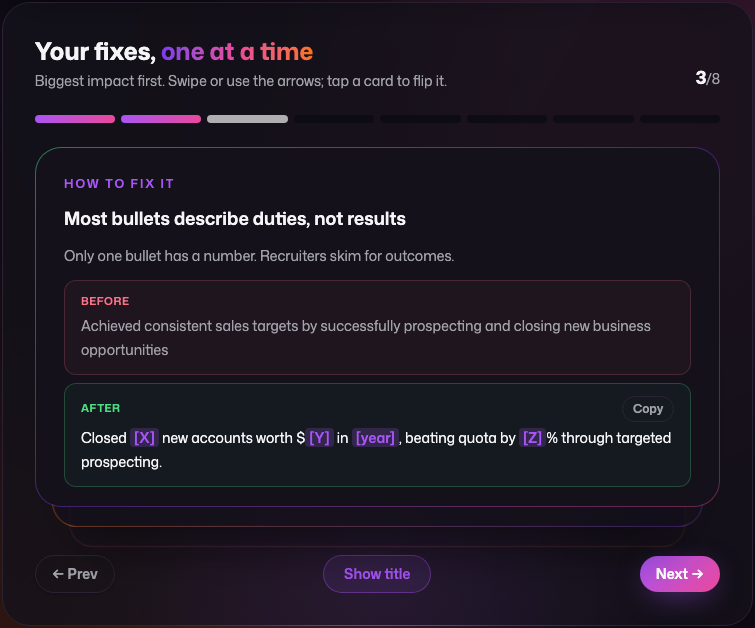

# GloUp: AI Resume Analyzer

**Score your resume against the job you actually want, then fix it line by line.**

Upload a PDF, paste a job posting, and GloUp returns an ATS score, a keyword match, a requirement-by-requirement role fit check, and concrete rewrites for your weakest bullets. You work through the fixes one at a time as flash cards.


## Features

- **Job-matched scoring.** An overall score plus five categories (ATS, Tone & Style, Content, Structure, Skills), each graded against the posting you paste in. No posting? It reviews the resume on its own merits.
- **Fixes as flash cards.** Every suggested fix, ranked by impact. Flip a card to see why it matters and how to fix it, then swipe to the next one.
- **Before/after rewrites.** For weak bullets, the AI quotes your original line and writes a stronger version. It never invents numbers: unknown metrics come back as `[X]%` placeholders for you to fill in, with one-click copy.
- **Keyword match.** Which key terms from the posting your resume already has, and which are missing.
- **Role fit.** Each requirement in the posting, marked met, partial, or missing, with evidence from your resume.
- **Quick checks.** Page count, word count, contact info, and how many bullets contain a number. These are computed straight from the PDF text, not guessed by the AI, and include a warning when a PDF is scanned and unreadable by ATS.
- **Dashboard.** Every analysis saved with its score and company logo. Sort by newest or top score, or delete ones you no longer need.

<table>
  <tr>
    <td></td>
    <td></td>
  </tr>
</table>


## How it works

```
PDF upload
  ├─ pdf.js renders page 1 to a PNG (preview) and extracts the text (quick checks)
  ├─ PDF + preview saved to the user's Puter cloud storage
  └─ PDF + job posting sent to Claude Haiku with a structured scoring prompt
        └─ JSON response parsed, validated and normalized
              └─ record saved to Puter's key-value store → review page
```

There's no traditional backend or database. [Puter.js](https://puter.com) provides sign-in, file storage, a key-value store, and access to Claude, so **each user's resumes live in their own Puter account**. AI usage runs on Puter's user-pays model: users sign in with a free Puter account, and analyses count against their own Puter allowance.

Some design decisions:

- **Facts come from code, judgment comes from the AI.** Page count, contact info, and quantified bullets are computed deterministically; the model handles scoring and rewrites.
- **The model output is never trusted as-is.** Responses are parsed tolerantly (code fences, stray prose) and normalized, so a malformed reply or an older saved record can't crash the UI.
- **The feedback schema is versioned.** Records carry a `schemaVersion`, and the UI hides sections an older record doesn't have.

## Tech stack

| Area | Tools |
|---|---|
| Framework | React 19, React Router 8 (framework mode, SSR), TypeScript |
| Styling & motion | Tailwind CSS 4, Motion |
| PDF processing | pdf.js (`pdfjs-dist`) |
| Auth, storage, AI | Puter.js (Claude Haiku 5.5) |
| State | Zustand |
| Uploads | react-dropzone |
| Company logos | Logo.dev (optional) |
| Build | Vite |

## Getting started

**Requirements:** Node.js 22.22+ (React Router 8 requires it) and a free [Puter](https://puter.com) account (you'll be asked to sign in on first visit).

```bash
git clone https://github.com/Joel-sari/GloUp-Resume-AI-Analzyer.git
cd GloUp-Resume-AI-Analzyer
npm install
cp .env.example .env   # optional, see below
npm run dev
```

Then open the URL Vite prints (http://localhost:5173 by default).

### Environment variables

| Variable | Required | Description |
|---|---|---|
| `VITE_LOGO_DEV_KEY` | No | **Publishable** key (`pk_…`) from [Logo.dev](https://www.logo.dev) for company logos. Without it, companies show a letter avatar. |

`VITE_` variables are bundled into the browser code at build time. Only put publishable keys there, never secret ones.

### Scripts

| Command | What it does |
|---|---|
| `npm run dev` | Start the dev server with hot reload |
| `npm run build` | Production build |
| `npm run start` | Serve the production build |
| `npm run typecheck` | Generate route types and run TypeScript |

## Project structure

```
app/
├── routes/            # home (dashboard), upload, resume/:id (review), auth
├── components/
│   ├── layout/        # Navbar, animated background
│   ├── review/        # review page: flash cards, ATS, role fit, checks, breakdown
│   ├── home/          # dashboard resume cards
│   ├── upload/        # file uploader, analysis progress
│   ├── score/         # score ring and badge
│   └── ui/            # accordion, company logo, shared primitives
├── lib/
│   ├── puter.ts       # Puter.js wrapper (auth, storage, KV, AI) as a Zustand store
│   ├── feedback.ts    # parse + validate the AI response
│   ├── score.ts       # score tiers, labels, fix ranking
│   ├── resumeChecks.ts # PDF text extraction + deterministic checks
│   └── pdftoimg.ts    # PDF → PNG preview
└── constants/         # scoring prompt and response schema
```

## Deployment

The included `Dockerfile` builds and serves the app:

```bash
docker build -t gloup .
docker run -p 3000:3000 gloup
```

It runs anywhere that runs Docker or Node (Fly.io, Railway, Render, Google Cloud Run, and similar). Because `VITE_` variables are read at build time, make sure `.env` is present when the image is built.

## Roadmap

- **Re-analyze and compare:** upload a revised version and see each score change ("Content 61 → 78 ↑")
- **Fix checklist:** tick off fixes as you go, with progress saved
- **Application tracker:** move each resume through applied → interview → offer
- **AI rewrite to PDF:** apply accepted rewrites and export a clean, ATS-friendly PDF
- **Cover letters and interview prep** generated from the gaps in the review

---

Built by [Joel Sari](https://github.com/Joel-sari).
